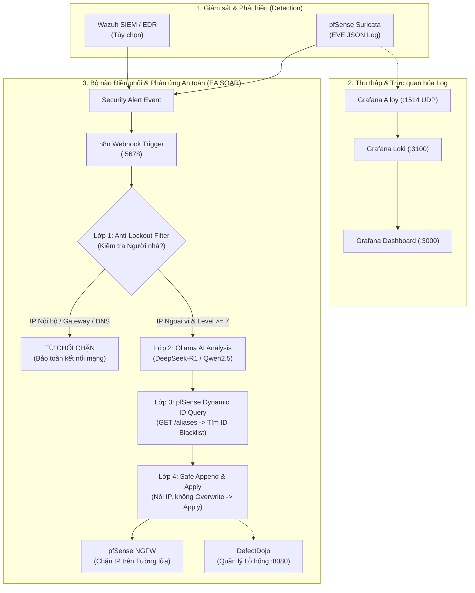

# EA — Automated SOAR & Security Operations Platform

> **Nền tảng Tự động hóa Điều phối và Phản ứng An ninh An toàn (Safe Security Orchestration, Automation and Response)** kết hợp giám sát mối đe dọa, phân tích AI cục bộ và thực thi phòng thủ mạng không gián đoạn.

---

## 1. Kiến trúc Tổng thể & Luồng Dữ liệu (Data Flow)

Hệ sinh thái **EA** được thiết kế để giải quyết bài toán lớn nhất của các hệ thống SOC tự động: **Phản ứng nhanh nhưng TUYỆT ĐỐI KHÔNG làm gián đoạn hạ tầng mạng và KHÔNG chặn nhầm "người nhà"**.



---

## 2. Điểm Khác Biệt: Cơ chế Chống Tự Tê Liệt Mạng (Anti-Self-Lockout)

Trong thực tế vận hành SOC/SIEM, việc dựng công cụ rất nhanh nhưng **điều chỉnh mã nguồn để không chặn nhầm hệ thống nội bộ** mới là yếu tố quyết định:
- **Nguy cơ Self-DoS:** Kẻ tấn công giả mạo IP nguồn (Spoofing) là IP của Gateway hoặc máy chủ SIEM $\rightarrow$ SOAR thông thường sẽ tự chặn luôn cổng mạng của chính mình.
- **Giải pháp của EA:** Tích hợp bộ lọc 4 lớp trong [ea-soar-pipeline.json](./compose/n8n/workflows/ea-soar-pipeline.json):
  1. **Strict CIDR & Asset Whitelist:** Loại trừ tự động toàn bộ IP Gateway, DNS, SIEM, máy chủ n8n và dải mạng riêng RFC 1918.
  2. **AI-Assisted Triage:** Ollama (DeepSeek-R1 / Qwen2.5) tóm tắt mối đe dọa, loại bỏ False Positive trước khi ra quyết định.
  3. **Dynamic Alias ID Matching:** Không fix cứng ID alias trên pfSense; tự động tra cứu ID theo tên `SOAR_Blacklist`.
  4. **Array Append (Không Overwrite):** Giữ nguyên toàn bộ các IP nguy hiểm đã chặn trước đó khi bổ sung IP mới.

---

## 3. Cấu trúc Thư mục Dự án

```text
EA/
├── compose/                        # Các dịch vụ Docker Compose lõi chạy độc lập
│   ├── n8n/                        # Bộ não SOAR, Workflow JSON và công cụ Test
│   │   ├── workflows/              # File Workflow n8n chuẩn (ea-soar-pipeline.json)
│   │   ├── test-soar-pipeline.ps1  # Script test luồng dữ liệu (PowerShell)
│   │   ├── test-soar-pipeline.sh   # Script test luồng dữ liệu (cURL)
│   │   ├── README.md
│   │   └── docker-compose.yml
│   │
│   ├── defectdojo/                 # Quản lý lỗ hổng bảo mật tập trung
│   │   ├── DefectDojo.txt          # Hướng dẫn lấy mật khẩu khởi tạo admin
│   │   ├── README.md
│   │   └── docker-compose.yml
│   │
│   ├── grafana-loki/               # Hứng Syslog pfSense và hiển thị Dashboard
│   │   ├── config.alloy            # Cấu hình Alloy hứng log UDP 1514
│   │   ├── loki-config.yaml
│   │   ├── README.md
│   │   └── docker-compose.yml
│   │
│   └── ollama/                     # AI phân tích an ninh cục bộ
│       ├── Ollama.txt              # Lệnh pull và test model
│       ├── README.md
│       └── docker-compose.yml
│
├── docs/                           # Hướng dẫn chi tiết cấu hình hạ tầng
│   ├── pfSense_n8n_SOAR_Workflow_Logic.md       # Logic cấu hình REST API trên pfSense
│   ├── Security_Lab_Setup_VPN.md                # Thiết lập VPN WireGuard & Tailscale
│   ├── SOAR_Deployment_Scripts_Implementation.md# Kịch bản lệnh PowerShell & cURL test
│   └── Pfsense.mp4                              # Video trực quan các bước cấu hình WebGUI
│
├── tools/                          # Thư mục chứa các công cụ lab ngoại tuyến (tùy chọn)
├── .env.example                    # File mẫu thiết lập toàn bộ API Key, Mật khẩu, Token
├── .gitignore                      # Chuẩn bảo vệ bí mật và dữ liệu phát sinh
└── README.md                       # Tài liệu tổng quan dự án
```

---

## 4. Hướng Dẫn Cấu Hình Bí Mật (API Key / Passwords)

Để đảm bảo an toàn tuyệt đối khi đưa dự án lên GitHub, toàn bộ thông tin nhạy cảm đã được chuyển sang dạng biến môi trường hoặc template placeholder:

1. **Tạo file `.env` cá nhân từ file mẫu:**
   ```powershell
   Copy-Item .env.example .env
   ```
2. **Điền các thông số hạ tầng thực tế của bạn vào `.env`:**
   - `PFSENSE_API_KEY`: API Key tạo từ package REST API trên pfSense.
   - `DD_ADMIN_PASSWORD`: Mật khẩu tài khoản quản trị DefectDojo.
   - `DD_SECRET_KEY` & `DD_CREDENTIAL_AES_256_KEY`: Khóa ngẫu nhiên dùng mã hóa dữ liệu.
   - `GRAFANA_ADMIN_PASSWORD`: Mật khẩu đăng nhập Grafana.
   *(File `.env` đã được cấu hình trong `.gitignore` để không bao giờ bị lộ ra ngoài).*

---

## 5. Khởi Chạy Nhanh Toàn Bộ Dịch Vụ

Mỗi dịch vụ trong thư mục `compose/` đều chạy độc lập và lưu trữ dữ liệu cục bộ. Bạn có thể khởi động từng dịch vụ tùy theo nhu cầu:

```bash
# 1. Khởi chạy n8n SOAR
cd "compose/n8n"
docker compose up -d

# 2. Khởi chạy Ollama AI (nếu dùng AI)
cd "../ollama"
docker compose up -d
docker exec -it ea-ollama ollama pull deepseek-r1:8b

# 3. Khởi chạy Logging (Loki, Alloy, Grafana)
cd "../grafana-loki"
docker compose up -d

# 4. Khởi chạy DefectDojo (nếu cần quản lý lỗ hổng)
cd "../defectdojo"
docker compose up -d
```

---

## 6. Kiểm Thử Luồng Dữ Liệu Ngay Lập Tức (Không Cần Cài Wazuh)

Hệ thống hỗ trợ kiểm thử chứng minh luồng SOAR ngay lập tức mà không cần phụ thuộc vào cụm Wazuh phức tạp:

1. Mở n8n tại `http://localhost:5678` -> Import file [ea-soar-pipeline.json](./compose/n8n/workflows/ea-soar-pipeline.json).
2. Điền API Key của pfSense vào các node HTTP Request tương ứng -> Bật **Active**.
3. Chạy kịch bản kiểm thử giả lập:

```powershell
cd "compose/n8n"
.\test-soar-pipeline.ps1
```

*(Hoặc dùng lệnh cURL với `./test-soar-pipeline.sh` trên Linux).*

### Kết quả kiểm thử trực quan:
- **Test Case 1 (Hacker ngoài Internet - 203.0.113.195):** n8n gọi Ollama AI $\rightarrow$ Xác nhận hành vi SSH Brute Force $\rightarrow$ Tìm ID alias pfSense $\rightarrow$ **Chặn thành công**.
- **Test Case 2 (Người nhà / Gateway - 192.168.2.1):** n8n phát hiện đây là tài sản cốt lõi $\rightarrow$ **Kích hoạt Safeguard Anti-Lockout $\rightarrow$ TỪ CHỐI CHẶN**, đảm bảo hạ tầng mạng luôn thông suốt.
